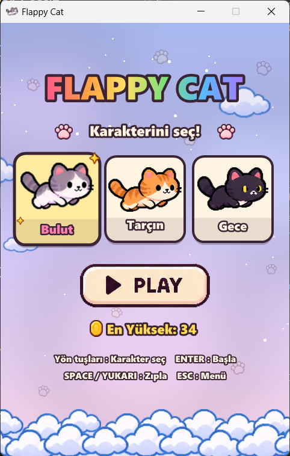
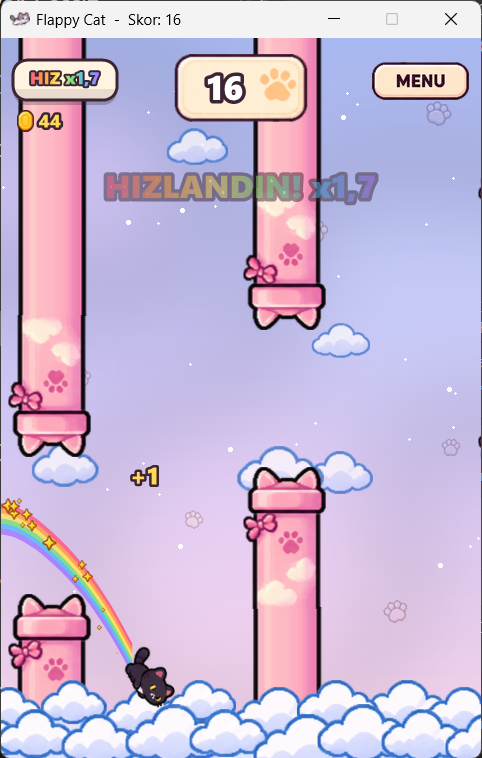
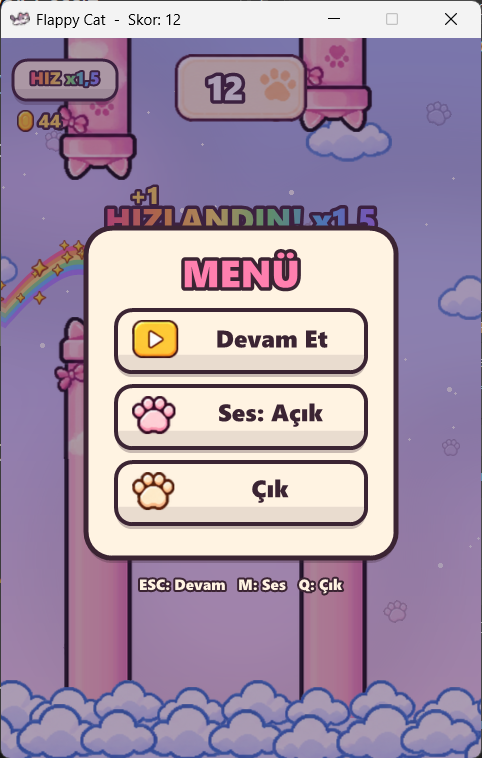
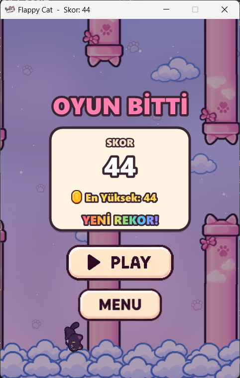

# Flappy Cat 🐱🌈

Windows Forms ile geliştirilmiş, **Flappy Bird benzeri** bir masaüstü oyunu. Oyuncu üç  kediden birini seçer, klavye ile kediyi zıplatır ve yer çekimi etkisiyle düşen kediyi sağdan sola gelen **kedi kulaklı engellerin** arasından geçirmeye çalışır. Hiç çarpmadan ilerledikçe oyun hızlanır ve kedinin kuyruğundan **gökkuşağı izi** çıkar.

Proje; Timer ile oyun döngüsü, klavye/fare olayları, çarpışma kontrolü ve oyun durumunun **nesne tabanlı** bir yapı ile yönetilmesini amaçlamaktadır.

> YMH219 Nesne Tabanlı Programlama – Ek Uygulama Ödevi 1

## Ekran Görüntüleri

| Karakter Seçimi | Oyun (Gökkuşağı İzi) |
|:---:|:---:|
|  |  |
| **Menü** | **Oyun Bitti** |
|  |  |

## Kullanılan Teknolojiler

- **C# / .NET 10** (`net10.0-windows`)
- **Windows Forms** – pencere, `Timer` ile oyun döngüsü, `Paint`, `KeyDown`/`KeyUp`/`PreviewKeyDown` ve fare olayları
- **GDI+ (System.Drawing)** – tüm çizimler (görseller, gökkuşağı izi, yazılar)
- **NuGet paketi:** [NAudio 2.2.1](https://www.nuget.org/packages/NAudio) – arka plan müziği ile efektleri aynı anda ve düşük gecikmeyle çalmak için
- **Visual Studio 2026**

## Kurulum ve Çalıştırma

1. Depoyu klonlayın:
   ```
   git clone https://github.com/SemanurBuhan/YMH219-FlappyBird.git
   ```
2. `FlappyCat.sln` dosyasını Visual Studio ile açın.
3. İlk derlemede NAudio paketi NuGet üzerinden otomatik indirilir. İndirilmezse: Çözüm Gezgini → çözüme sağ tık → **NuGet Paketlerini Geri Yükle**.
4. **F5** veya **Ctrl+F5** ile çalıştırın.

Gereksinim: Windows 10/11 ve .NET 10 SDK.

## Oyun Kontrolleri

| Tuş / Fare | İşlev |
|---|---|
| `←` `→` veya kedi kartına tıklama | Karakter seçimi |
| `Enter` veya **PLAY** | Oyunu başlat / yeniden başlat |
| `Space`, `↑`, `W` veya ekrana tıklama | Zıpla |
| `Esc`, `P` veya **MENU** | Oyunu durdur, menüyü aç |
| `M` (menüde) | Sesi aç / kapat |
| `Q` (menüde) | Ana menüye dön |

## Temel Özellikler

- **Karakter seçimi:** Bulut (gri), Tarçın (turuncu) ve Gece (siyah) kedilerinden biri seçilip **PLAY** ile oyun başlar.
- **Fizik:** Kedi tuşa basınca yukarı zıplar, yer çekimi etkisiyle aşağı düşer; düşey hızına göre başını yukarı/aşağı eğer.
- **Engeller:** Aynı anda 3 engel çifti sağdan sola hareket eder; ekrandan çıkan engel rastgele bir boşlukla yeniden sağa yerleştirilir.
- **Çarpışma:** Kedi bir engele veya bulut zemine çarptığında oyun durur, "PAT!" efekti ve **Oyun Bitti** ekranı gösterilir.
- **Skor:** Her geçilen engel için skor 1 artar; en yüksek skor bilgisayarda bir dosyada saklanır, rekor kırılınca "YENİ REKOR!" yazısı çıkar.
- **Hızlanma ve gökkuşağı:** Hiç çarpmadan her 3 engelde bir oyun hızlanır (en fazla 8 seviye). Hızlandıkça kedinin kuyruğundan uzayan ve kalınlaşan bir gökkuşağı izi çıkar.
- **Menü:** Oyun sırasında **MENU** ile açılır: *Devam Et*, *Ses: Açık/Kapalı* ve *Çık* (ana menüye dönüş). Pencereden çıkılırsa oyun otomatik duraklar.
- **Sesler:** Arka planda sürekli çalan sakin bir müzik, butonlarda yumuşak bir ses ve çarpışmada kedi miyavlaması.
- **Yeni Oyun / Yeniden Başlat:** Oyun Bitti ekranındaki **PLAY** butonu veya `Enter`.

## Proje Yapısı

```
FlappyCat/
├── Cekirdek/
│   ├── OyunNesnesi.cs      → Tüm oyun nesnelerinin soyut (abstract) temel sınıfı
│   ├── OyunYoneticisi.cs   → Skor, hız, hız seviyesi, oyun durumu, çarpışma kontrolü
│   ├── OyunDurumu.cs       → AnaMenu, Hazir, Oynuyor, Duraklatildi, OyunBitti (enum)
│   ├── KarakterTuru.cs     → Seçilebilir kediler (enum)
│   ├── Ayarlar.cs          → Yer çekimi, zıplama gücü, hız gibi sabitler
│   └── Varliklar.cs        → Görsellerin yüklenmesi
├── Nesneler/               → OyunNesnesi'nden türeyen sınıflar
│   ├── Kedi.cs, EngelCifti.cs, Bulut.cs, Zemin.cs
├── Efektler/
│   ├── GokkusagiIzi.cs, Parcacik.cs, YuzenYazi.cs
├── Arayuz/
│   ├── EkranArayuzu.cs     → Ekranların çizimi, klavye/fare girdileri
│   ├── Buton.cs, Cizim.cs, Renkler.cs
├── Servisler/
│   ├── SesYoneticisi.cs    → Müzik ve efektler (NAudio karıştırıcı)
│   ├── OnbellekSes.cs, SesKaynaklari.cs
│   └── SkorDeposu.cs       → En yüksek skorun dosyaya kaydı
├── Assets/                 → Görseller (Sprites) ve sesler (Sounds)
├── OyunFormu.cs            → Pencere, Timer döngüsü ve olaylar
└── Program.cs
```

- `Kedi`, `EngelCifti`, `Bulut` ve `Zemin` sınıfları soyut `OyunNesnesi` sınıfından türer ve `Guncelle` / `Ciz` metotlarını **override** eder.
- Hız, skor, hız seviyesi ve oyun durumu `OyunYoneticisi` sınıfının **özellikleri (property)** ile yönetilir.
- `OyunYoneticisi`, skor değiştiğinde ve oyun bittiğinde **olay (event)** yayınlar.
- Dosya ve ses işlemlerinde hatalar `try/catch` ile yakalanır; dosya bulunamazsa kullanıcıya mesaj gösterilir, ses aygıtı yoksa oyun sessiz devam eder.

## Bilinen Sınırlamalar / Geliştirme Notları

- Pencere boyutu sabittir (480×720) ve büyütülemez.
- NAudio'nun ses çıkışı ve Windows Forms nedeniyle yalnızca **Windows** üzerinde çalışır.
- En yüksek skor `%LOCALAPPDATA%\FlappyCat\enyuksekskor.txt` dosyasında, yalnızca o bilgisayar için saklanır.
- Geliştirme fikirleri: zorluk seviyesi seçimi, engellerin arasında toplanabilir altınlar, karaktere özel yetenekler, çevrim içi skor tablosu.

## Öğrenci

- **Ad Soyad:** Semanur Buhan
- **Öğrenci No:** 250541007
- **Ders:** YMH219 Nesne Tabanlı Programlama
